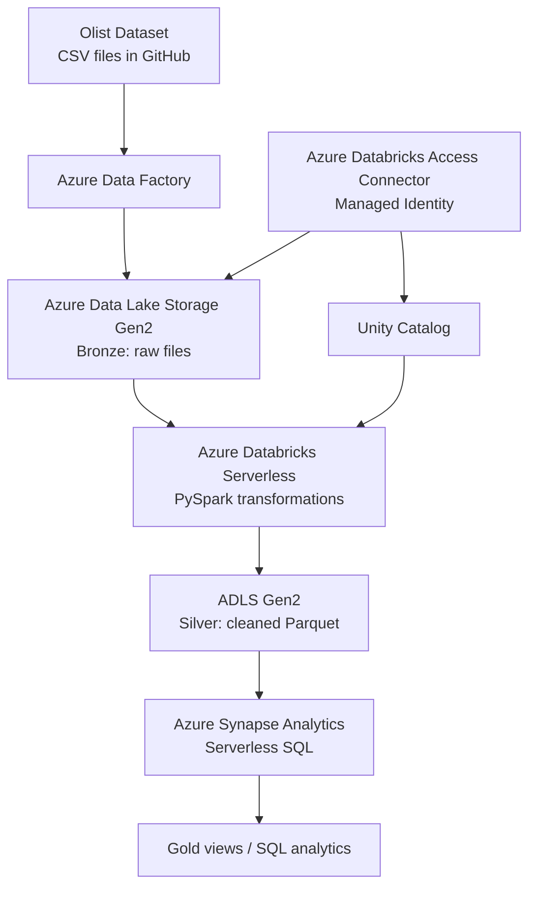
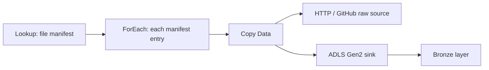

An end-to-end data engineering project using the **Olist Brazilian E-Commerce dataset** to demonstrate data ingestion, data lake organization, distributed processing, and SQL-based analytics on Microsoft Azure.

> **Project status:** This README describes the architecture and implementation explored in this project. Validate each pipeline stage and update the status as the end-to-end workflow is successfully tested.

## Architecture



## Technology Stack

| Technology | Purpose |
|---|---|
| Microsoft Azure | Cloud platform |
| Azure Data Factory (ADF) | Data ingestion and pipeline orchestration |
| Azure Data Lake Storage Gen2 (ADLS Gen2) | Central data lake storage |
| Azure Databricks Serverless | Distributed data processing |
| Apache Spark / PySpark | Data transformations and joins |
| Unity Catalog | Data governance and storage access configuration |
| Azure Databricks Access Connector | Managed-identity-based access to ADLS |
| Azure Synapse Analytics Serverless SQL | SQL querying of Parquet data and views |
| Python, Pandas | Data manipulation and supporting code |
| GitHub | Source data repository / version control |
| CSV, JSON, Parquet | Data formats |

## Dataset

The project uses the Olist e-commerce dataset, which contains separate files for orders, customers, payments, items, products, sellers, and reviews.

Datasets used:

- `olist_orders_dataset.csv`
- `olist_order_payments_dataset.csv` (the payment source was also encountered as `olist_order_payments.txt` in Azure Storage; confirm the final filename/path)
- `olist_order_items_dataset.csv`
- `olist_customers_dataset.csv`
- `olist_products_dataset.csv`
- `olist_sellers_dataset.csv`
- `olist_order_reviews_dataset.csv`
- `product_category_name_translation.csv`

## Data Lake Structure

Target organization:

```text
olistcontainer/
├── bronze/
│   └── <raw source files>
├── silver/
│   └── <cleaned and transformed Parquet datasets>
└── gold/
    └── <analytics-ready datasets, if materialized>
```

The actual source paths may differ depending on the ADF sink configuration. Confirm the paths in ADLS before running notebooks or SQL queries.

## Pipeline Workflow

### 1. Ingestion with Azure Data Factory

The planned ADF workflow uses a JSON manifest to drive ingestion:



The manifest contains fields such as `csv_relative_url` and `file_name`. The pipeline uses:

- **Lookup** to read the file manifest.
- **ForEach** to iterate through file entries.
- **Copy Data** to download each file from the HTTP source and write it to ADLS Gen2.
- Parameterized source paths and destination filenames to reuse the same datasets and activities.

Example GitHub raw base URL used during setup:

```text
https://raw.githubusercontent.com/Ishaan123jain/
```

### 2. Storage and access configuration

ADLS Gen2 was configured with a storage account and container. Databricks access was set up using:

- Azure Databricks Access Connector
- Unity Catalog storage credential
- Unity Catalog external location
- Azure managed identity / storage role assignments

Example ADLS URI pattern:

```text
abfss://<container>@<storage-account>.dfs.core.windows.net/<path>/
```

Do not place account keys, client secrets, SAS tokens, passwords, or other credentials in this repository. Use secret scopes or Azure-managed identity-based access where applicable.

### 3. Processing with Azure Databricks and PySpark

The processing workflow reads raw CSV data into Spark DataFrames, validates schemas, cleans data, and joins related datasets.

Example CSV read:

```python
orders_df = (
    spark.read.format("csv")
    .option("header", "true")
    .option("inferSchema", "true")
    .load(orders_path)
)
```

Core relationships include:

| Dataset relationship | Join key |
|---|---|
| Orders ↔ Payments | `order_id` |
| Orders ↔ Customers | `customer_id` |
| Orders ↔ Order Items | `order_id` |
| Order Items ↔ Products | `product_id` |
| Order Items ↔ Sellers | `seller_id` |
| Orders ↔ Reviews | `order_id` |

Example join pattern:

```python
orders_payments_df = orders_df.join(
    payments_df, on="order_id", how="left"
)

orders_customer_df = orders_payments_df.join(
    customers_df, on="customer_id", how="left"
)

orders_items_df = orders_customer_df.join(
    items_df, on="order_id", how="left"
)

orders_products_df = orders_items_df.join(
    products_df, on="product_id", how="left"
)

final_df = orders_products_df.join(
    sellers_df, on="seller_id", how="left"
)
```

**Data modeling note:** Orders, payments, items, and reviews can have one-to-many relationships. Joining all of them at once may multiply rows. Define the intended grain (for example, order-level, item-level, or payment-level) and aggregate where necessary before calculating metrics.

### 4. Silver layer

The Silver layer is intended for cleaned and standardized datasets stored as Parquet. Typical processing includes:

- Schema and data-type standardization
- Date and timestamp parsing
- Handling nulls and malformed records
- Duplicate checks
- Key and relationship validation
- Writing transformed data to Parquet

Example write:

```python
silver_path = (
    "abfss://<container>@<storage-account>.dfs.core.windows.net/"
    "silver/orders/"
)

orders_df.write.mode("overwrite").parquet(silver_path)
```

Use `overwrite` only when replacing the target dataset is intended.

### 5. Analytics with Azure Synapse Serverless SQL

Synapse Serverless SQL can query Parquet files in the data lake using `OPENROWSET`. Example (adjust the path to the exact dataset and configure storage authentication first):

```sql
SELECT TOP 100 *
FROM OPENROWSET(
    BULK 'https://<storage-account>.dfs.core.windows.net/<container>/silver/orders/*.parquet',
    FORMAT = 'PARQUET'
) AS rows;
```

An analytics view can apply business filters, for example delivered orders:

```sql
CREATE OR ALTER VIEW gold.final2
AS
SELECT *
FROM OPENROWSET(
    BULK 'https://<storage-account>.dfs.core.windows.net/<container>/silver/orders/*.parquet',
    FORMAT = 'PARQUET'
) AS rows
WHERE order_status = 'delivered';
```

The Gold layer may be implemented as materialized analytics-ready files or SQL views, depending on the final design. Ensure the `OPENROWSET` path points to a single dataset with a compatible schema.

## Key Engineering Concepts Demonstrated

- Parameterized and metadata-driven ingestion
- Azure data lake storage organization (Bronze / Silver / Gold)
- PySpark DataFrame transformations and joins
- CSV and Parquet handling
- Unity Catalog storage credentials and external locations
- Managed identity and Azure RBAC
- Serverless SQL querying with `OPENROWSET`
- Debugging path, schema, authentication, and ambiguous-column issues

## Setup and Execution

1. Provision the Azure resources required for the project (ADF, ADLS Gen2, Databricks, and Synapse Serverless SQL).
2. Upload or ingest the Olist source files into the Bronze layer.
3. Configure ADF linked services, datasets, manifest, and pipeline parameters.
4. Configure Databricks access to ADLS through Unity Catalog and the Access Connector.
5. Open the Databricks notebook and update the paths to match the actual storage layout.
6. Run the ingestion, data validation, cleaning, and transformation steps.
7. Write the cleaned datasets to Silver (Parquet).
8. Configure Synapse storage authentication and query a specific Parquet dataset.
9. Create and test the Gold views or analytics datasets.


## Future Enhancements

- Complete and validate the full ADF → ADLS → Databricks → Synapse flow.
- Add pipeline monitoring, failure handling, and retry policies.
- Implement incremental ingestion and idempotent processing.
- Add data quality checks and reconciliation (row counts, null checks, key uniqueness).
- Consider Delta Lake for Silver/Gold transactional tables.
- Add partitioning strategies for large datasets.
- Create analytics queries or a dashboard for revenue, order status, payment methods, product performance, and seller performance.
- Document verified run results and measured performance.

## Acknowledgements

- **Olist Brazilian E-Commerce dataset** — Kaggle, used as the project's sample e-commerce data.
- Microsoft Azure documentation for Azure Data Factory, ADLS Gen2, Azure Databricks, Unity Catalog, and Azure Synapse Analytics.

---

**Author:** Ishaan Jain  
**Project:** Azure E-Commerce Data Engineering Pipeline
"""
path = Path("/mnt/data/README.md")
path.write_text(readme, encoding="utf-8")
print(f"Created {path} ({path.stat().st_size} bytes)")
